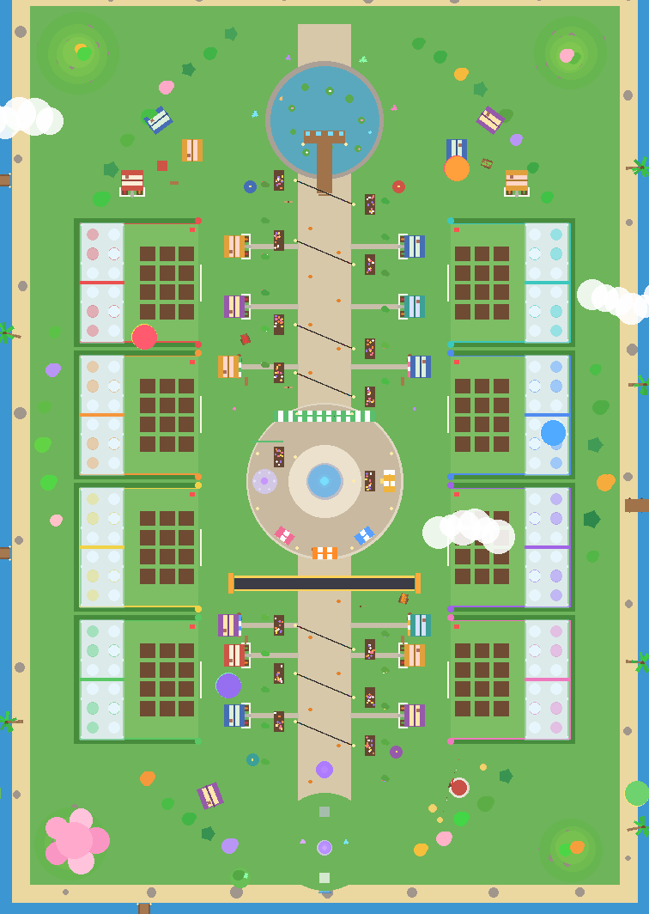

# Sproutling Isles (Roblox)

A grow-and-snatch simulator. Plant seeds, hatch Sproutlings (plant-creatures that earn Dew
every second), guard your greenhouse gate, and steal rare Sproutlings from your neighbours.
The full game design doc lives in Claude Docs (linked from the PR/session); this folder is the playable build.



## Open it in Roblox Studio

**Quickest:** open `build/SproutlingIsles.rbxlx` in Studio (File > Open from File). The map is
already baked in, and all scripts are in place. Press **Play**.

The hills, lagoon and sea around the island are Roblox Terrain generated by
`src/server/TerrainBuilder.luau` when the server starts, so they only appear after you press **Play**
(it takes a few seconds; the hills fill in as it goes). Their shape lives in `src/shared/Landscape.luau`.

**Live-sync while editing code (recommended for development):**

```bash
# once: install Rojo (https://rojo.space) and the Rojo Studio plugin
rojo serve            # from this folder
```

In Studio open the baked place, then click **Connect** in the Rojo plugin. Code edits in `src/`
sync instantly.

### Rebuild the place file

```bash
rojo build -o build/SproutlingIsles.rbxlx
lune run tools/bake-map build/SproutlingIsles.rbxlx   # bakes the map so it's visible in edit mode
```

Without Lune you can bake from Studio's command bar instead:
`require(game.ReplicatedStorage.Shared.MapBuilder).Build(workspace)`. The server also builds
the map at runtime if `Workspace.Map` is missing.

## Combat (RPG step 2)

Controls: **click** attack (R2 on gamepad), **Shift** dodge roll (B), **1 2 3** sword / bow / staff,
**Q X C** Whirlwind / Firebolt / Second Wind. Phones get on-screen Hit, Roll, ability and Swap buttons.

Try it: training dummies stand in the barracks yard in the city (south-east of the arena); monster
camps (slimes, goblins, wolves) are out on the hills and spawn once the terrain has loaded. Tuning
lives in `src/shared/Combat.luau`; the server code is `CombatService.luau` and `EnemyService.luau`,
the client code `src/client/Combat.luau`.

## Dungeon, field boss and loot (RPG step 3)

- **The Hollow Crypt**: walk onto the purple portal in the hilltop castle's courtyard (west bridge, then
  the path up). Six rooms: entry hall, crypt hall, bat cavern, ossuary, treasure vault, and the Bone
  Warden's chamber. Clearing a room raises the portcullis to the next. Chests open once per player
  per run; the crypt resets 2 minutes after the Warden falls or after a minute empty.
- **Ironbark, the Old Grove**: a field boss in the clearing past the north-west hamlet (respawns
  every 5 minutes). Bosses telegraph every attack with a red marker on the ground.
- **Loot**: monsters drop materials and sometimes weapons (Common to Legendary, x1.0 to x2.1 damage);
  only the player who earned a drop can pick it up. A better weapon upgrades yours; a worse one is
  salvaged for Dew. Code: `src/shared/Loot.luau`, `DungeonBuilder.luau`, `src/server/LootService.luau`,
  `DungeonService.luau`.

## Inventory and shops (RPG step 4)

- **B** (or the Bag button) opens the inventory: equipped weapons and armour, the weapon bag (equip,
  salvage), potions and meals (use), materials. **H** drinks a Healing Draught, **J** a Stamina Tonic.
- Walk up to a shop in the city and press its prompt: Blacksmith (swords), Fletcher (bows), Enchanter
  (staffs), Armorer (three armour tiers that block 8/16/25% of damage), Alchemist (potions), the
  tavern, Cook and the airship-port inn (meals). Every open shop buys your materials. Other trades
  say they open in a later update. Catalogue: `src/shared/Shops.luau`; server `InventoryService.luau`;
  client `src/client/Inventory.luau`.

## Companions, horses and fast travel (RPG step 6)

- **Beast Tamer** (250 Dew): press **P** to call your best Sproutling. It floats at your shoulder and
  zaps the nearest monster every 1.8 s; its damage scales with that Sproutling's Dew/s.
- **Stables** (800 Dew): press **V** to ride a horse (+14 walk speed). It can't enter the crypt.
- **Skyward Shipyard** (airship port) and **Shipwright** (fishing docks) list destinations in their shop
  window: 40 Dew by air, 25 by sea. Destinations: `src/shared/Travel.luau`.
- Phones get Pet / Ride buttons once bought. Server: `CompanionService.luau`, `TravelService.luau`.

## Before publishing

1. **Game Settings > Security:** turn on *Enable Studio Access to API Services* (for saving).
2. **Game Settings > Places:** set **Max Players to 8** (one plot per player).
3. **Creator Dashboard:** create the 5 game passes and 8 developer products listed in
   `src/shared/Products.luau`, then paste their IDs into that file. Items with ID `0` show
   "Set ID" in the in-game store and can't be bought.
4. Set `Config.StudioTestPasses = true` in `src/shared/Config.luau` to try every pass perk while
   play-testing in Studio. Set it back to false before publishing.
5. Test snatching with **Test > Clients and Servers > 2 players**. `Config.StudioDisableShield`
   (default true) turns off the 15-minute new-player shield, but only inside Studio. Live servers
   ignore it. The victim bonks a thief with **R** (gamepad **Y**).
6. **Textures:** upload the 12 images in `assets/textures/` (Asset Manager > Bulk Import) and paste
   their asset IDs into `src/shared/MaterialKit.luau`. Until then the royal kit stays off.

### Performance (phones)

About 18,900 baked parts. **Streaming is on** (`default.project.json`: target radius 640, min 128), so
phones load only what's near them. The plaza shop, Rebirth Shrine and Sprout Supply are Persistent,
because the HUD reads their labels from anywhere. Plots and animated props are Atomic. Server teleports
(home, crypt, fast travel) call `RequestStreamAroundAsync` before moving you.

## Code map

| Path | What it does |
| --- | --- |
| `src/shared/Config.luau` | Every tunable: prices, timers, lock length, rebirth cost, daily rewards |
| `src/shared/Species.luau` | 13 Sproutling species (rarity, price, grow time, Dew/s, colours) |
| `src/shared/Weather.luau` | Weather types and the mutations they apply |
| `src/shared/Products.luau` | Robux game passes and developer products |
| `src/shared/MapBuilder.luau` | Builds the whole island from parts (runs in Studio, server and Lune) |
| `src/shared/SproutModel.luau` | Builds a Sproutling's look and computes its income |
| `src/server/init.server.luau` | Bootstrap, player lifecycle, income tick, autosave |
| `src/server/DataService.luau` | DataStore load/save with session locking |
| `src/server/PlotService.luau` | Plot claim, planting, hatching, pads, selling, gate lock |
| `src/server/SnatchService.luau` | Snatch, carry, bonk, return |
| `src/server/ShopService.luau` | Seed Shop restocks, Sell Stand, Pollen Parade belt |
| `src/server/WeatherService.luau` | Weather cycle, sky tint, mutation and size rolls |
| `src/server/PondService.luau` | Wishing Pond and Sky Well loot |
| `src/server/ProgressionService.luau` | Rebirth, daily streak, Sky Garden pads |
| `src/server/MonetizationService.luau` | Pass ownership and receipt processing |
| `src/client/init.client.luau` | HUD, seed hotbar, toasts, store, prompt visibility, weather FX |

## Lint

```bash
selene src tools   # uses roblox_min.yml (a minimal Roblox std that works offline)
```
